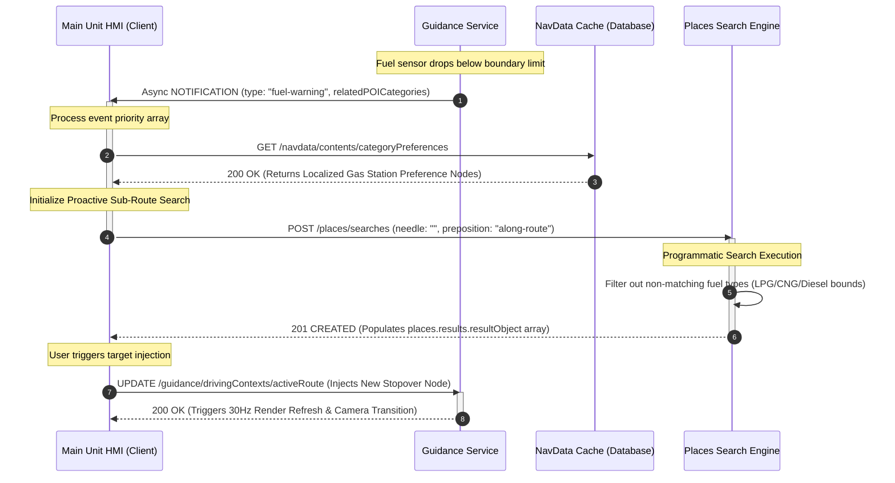

# MIB3 Connected Navigation System: API Hub & Architectural Specifications

[](https://stoplight.io)
[]()
[]()

This repository serves as a core **API Documentation Hub** demonstrating enterprise-grade architectural specifications, cross-domain interaction models, and asynchronous data schemas for the automotive infotainment system cluster (VW MIB3 / MEB ICAS platform). 

The module highlights the serialization of low-level vehicle bus telemetry (CAN-FD, Ethernet/UDP) into high-level, event-driven RESTful/WebSocket interfaces (RSI/ViWi).

---

## 🏗️ Domain Service Architecture

The core middleware layer is split into four independent, highly serialized resource domains communicating via a centralized Car Functions Adapter (CFA) IPC routing table:

```text
       +-----------------------------------+

       |        Main Unit HMI Client       |
       +-----------------------------------+
                         |
+------------------------+------------------------+

| (REST / WebSockets over Vehicle Interface)     |
v                                                 v
+---------------------+                            +---------------------+

|  guidance.service   |                            | maprenderer.service |
| ------------------- |                            | ------------------- |
| - GNSS Car Tracking |                            | - Viewport Matrices |
| - Maneuvers Logic   |                            | - Layer Displace    |
| - Hazard Alerts     |                            | - Touch targets     |
+---------------------+                            +---------------------+

|                                                 |
+------------------------+------------------------+
                         |
                         v
+---------------------+                            +---------------------+

|   navdata.service   |                            |  tripview.service   |
| ------------------- |                            | ------------------- |
| - User Profiles     |                            | - Linear Trip Lines |
| - Favorites Database|                            | - Stopover Detours  |
| - ETC Card Reader   |                            | - Track Truncation  |
+---------------------+                            +---------------------+
```

---

## 🔄 Sequence Workflow: Contextual Telemetry & Proactive Search Gating

The diagram below details the multi-service pipeline executed when an internal sensor alert triggers an asynchronous background search sequence, modifying active route parameters on-the-fly inside the `guidance.service` and `maprenderer.service` layers:



---

## 🛠️ Technology Stack & Methodologies

*   **API Specifications:** OpenAPI 3.1 (REST endpoints) & AsyncAPI / WebSockets paradigm.
*   **Methodology:** Docs-as-Code, Git-driven editorial loops, Pull Request peer validation.
*   **Automation (CI/CD):** GitHub Actions pipelines executing automated formatting checks.
*   **Validation & Linting:** Spectral API Linter rulesets for payload contract compliance.
*   **Visualization:** Diagrams-as-Code via embedded Mermaid.js engine frameworks.

---

## 🔒 Confidentiality & Safe Identification Note

> [!IMPORTANT]
> All interface components, signal representations, JSON payload structures, and architectural attributes within this repository are modeled strictly based on **publicly available industry specifications** (such as *MISRA C++:2008*, *AUTOSAR Adaptive Platform Requirements*, and open *DBC/XSD schema* blueprints). All contents are completely **anonymized, synthesized, and free of any proprietary OEM code base or active NDA constraints**. It serves exclusively as a standalone technical documentation sample.
