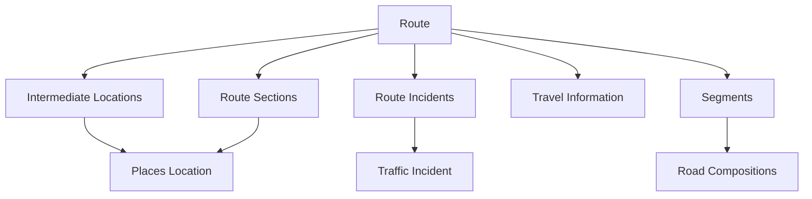
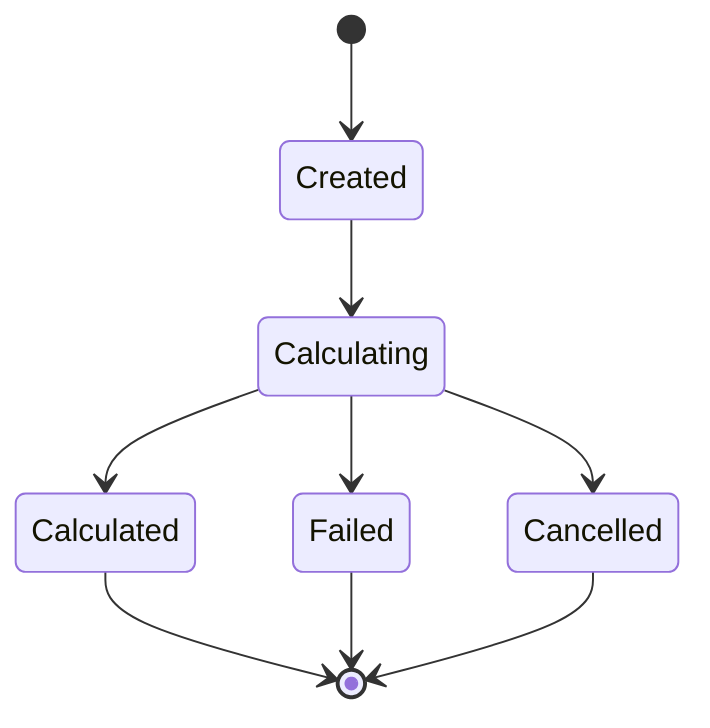

# Route Planning Service — Architecture

## 1. Overview

This document describes the logical architecture of the Route Planning Service based on the available resource definitions, functional descriptions, and selected C++ client-library source files.

It focuses on:

- Route calculation and lifecycle
- Relationships between routing resources
- Route alternatives and travel information
- Client-library service handling
- Subscription-related observations

The available source materials do not provide a complete deployment architecture or a full description of runtime communication. The diagrams below therefore represent logical relationships, not a verified infrastructure topology.

## 2. Logical Resource Model

The resource model consists of routes and related resources that provide location, section, incident, segment, and travel information.

**Interpretation**

- A route references its intermediate locations and route sections.
- Route incidents associate traffic incidents with a route.
- Travel information is associated with a route through the `track` reference.
- The property-access matrix describes route segments and their road compositions.
- Intermediate locations and route sections may reference Places locations.

The diagram represents relationships described in the source artifacts. It does not establish database storage, ownership, or physical service boundaries.

## 3. Route Lifecycle

The functional description and resource model indicate the following logical lifecycle.

The route resource defines these states:

- `calculating`
- `calculated`
- `failed`
- `cancelled`

The source does not define a separate `re-calculating` state. It states that a changed route variant should be created as a new route.

The diagram is a conceptual representation of the listed states. Exact transition triggers, retry behavior, and cancellation semantics are not fully specified.

## 4. Route Creation and Modification

The source materials describe two route-related POST operations:

- Collection-level POST creates a route.
- Element-level POST updates a single route.

The route creation property list includes:

- `destinationLocation` — required
- `incidentsToAvoid` — optional
- `intermediateLocations` — optional
- `maximumNumberOfAlternativeRoutes` — optional
- `name` — optional
- `startLocation` — optional

According to the JSON specification, an undefined `startLocation` means the current vehicle position is used.

The property-access matrix identifies a smaller set of properties that can be changed through the element-level update operation. In particular, it marks `destinationLocation` and `intermediateLocations` as update-settable.

The exact semantics of the POST operations, including whether omitted properties are retained or reset, require confirmation.

## 5. Alternative Routes

The route model contains:

- `alternativeRoutes`
- `isRecommended`
- `maximumNumberOfAlternativeRoutes`
- `type`

The functional description sets context-dependent limits on alternative routes.

| Context | Maximum alternatives |
|---|---:|
| Single-location travel information | 0 |
| Route calculation in overview | 2 |
| Active route guidance | 2 |
| HomeView destinations | 0 |
| Predicted route without active guidance | 2 |
| TripView travel information | 0 |

The JSON specification states that only recommended routes can contain alternative routes.

Clients are expected to monitor route changes because better or faster alternatives may become available over time.

The source does not fully define how alternatives are ranked, how long they remain available, or how recursive alternative-route references are bounded.

## 6. Intermediate Locations and Route Constraints

The functional description defines limits for intermediate route elements.

| Element | Maximum |
|---|---:|
| Stopovers | 3 |
| Via-points | 4 |
| Interchange entrances | 1 |
| Interchange exits | 1 |

Exceeding these limits is stated to result in `409 Conflict`.

The resource model also contains additional location types, including charging-related variants. The supported type values differ between source artifacts; see [Open Issues](open-issues.md).

The functional description notes that a highway point added as a stopover can be removed from the stopovers, but does not define specific highway-point actions.

## 7. Travel Information

The `travelInformation` resource provides route-related information such as:

- Total distance and distance units
- Travel time and travel-time adjustment
- Distance on highways, ferries, toll roads, vignette roads, and seasonally restricted roads
- Toll costs and related icons
- Interchange entrance and exit information
- City-restriction information
- Energy-related values in one of the supplied resource definitions

The functional description maps selected presentation values to resource properties.

| Presentation value | Source property or calculation |
|---|---|
| Distance (`DTT`) | `routing.travelInformation.distance` and `distanceUnit` |
| Travel time (`RTT`) | `routing.travelInformation.travelTime` |
| Estimated arrival time (`ETA`) | Current client system time plus `travelTime` |
| Highway distance | Corresponding highway-distance property |
| Ferry distance | Corresponding ferry-distance property |
| Toll-road distance | Corresponding toll-road-distance property |
| Vignette-road distance | Corresponding vignette-road-distance property |
| Seasonally restricted road distance | Corresponding seasonally restricted road property |
| Via information | `routing.route.viaInformation` |
| City restrictions | `routing.travelInformation.includesCityRestrictions` |

The ETA is described as a client-side calculation in the functional source. The available materials do not establish a dedicated server-side ETA property.

## 8. Semi-Dynamic Route Information

The functional description identifies information that can change when a better route becomes available.

| Value | Description |
|---|---|
| `DTDDifference` | Distance difference between the better route and the current route |
| `RTTDifference` | Travel-time difference between the better route and the current route |
| Via information | Via information associated with the better route |

The source does not specify exact formulas, sign conventions, rounding, or event payload structures for these values.

## 9. Client-Library Architecture

### 9.1 Routing Service Handler

The reviewed `RoutingServiceHandler` class is a specialized service handler for the routing microservice.

Its declaration shows that it:

- Inherits from `Client::ServiceHandler`.
- Receives an `INavSdInterface` pointer through its constructor.
- Overrides `LogServiceAvailability()`.
- Declares a virtual destructor.

The reviewed implementation shows that:

- The constructor passes the routing service identifier and client interface to the base class.
- The destructor is empty.
- `LogServiceAvailability()` checks service availability through `isAvailable()`.
- The method logs either `AVAILABLE` or `NOT AVAILABLE`.
- When performance logging is enabled, elapsed time is also logged.

The reviewed files do not show route calculation, resource CRUD operations, or routing-specific event payload processing implemented by this class.

### 9.2 Related Client Components

Other reviewed declarations provide context about adjacent client-library components.

| Component | Observed responsibility |
|---|---|
| `GuidanceServiceHandler` | Exposes driving-context and current-position-related information |
| `SimpleNavigationServiceHandler` | Exposes navigation-related state and destination information |
| `TimeServiceHandler` | Exposes date and time information |
| `UnitServiceHandler` | Exposes unit-related information |
| `WebSocketResponseObject` | Represents WebSocket response types and provides access to data and error information |

These observations describe the reviewed declarations. They do not prove the complete runtime interaction sequence or establish that each component is directly invoked by the Routing Service Handler.

### 9.3 WebSocket Response Object

The reviewed `WebSocketResponseObject` declaration identifies response categories:

- `TYPE_SUBSCRIBE`
- `TYPE_UNSUBSCRIBE`
- `TYPE_DATA`
- `TYPE_ERROR`

It also declares accessors and conversion-related methods for response data and errors.

The available header does not establish the complete wire-level JSON schema, event envelope, or payload format.

## 10. Subscription Model

The property-access matrix indicates subscription support at two levels:

- Element-level subscriptions
- Resource-level subscriptions

The capability matrix can be summarized as follows.

| Resource | Element subscription | Resource subscription |
|---|---:|---:|
| `routes` | Yes | Yes |
| `intermediateLocations` | No | Yes |
| `routeSections` | Yes | No |
| `routeIncidents` | Yes | No |
| `segments` | Yes | No |
| `roadCompositions` | Yes | No |
| `travelInformation` | Yes | Yes |

The matrix identifies capabilities, but does not define:

- Subscription request and response schemas
- Event names and payload structures
- Ordering guarantees
- Delivery guarantees
- Reconnection behavior
- Subscription lifetime and cleanup rules

These details require additional authoritative interface documentation.

## 11. Architecture Boundaries and Evidence

The following distinctions are important when interpreting the available source materials.

| Evidence | What it supports | What it does not establish |
|---|---|---|
| Resource specification | Logical resources, properties, references, and listed operations | Complete HTTP API contract |
| CRUD/property matrix | Operation capabilities and property-level write permissions | Internal persistence or implementation logic |
| Functional description | Route constraints and selected presentation mappings | Complete algorithms or event schemas |
| Routing service-handler header | Class inheritance and declared interface | Runtime behavior not implemented in the reviewed class |
| Routing service-handler implementation | Service availability logging behavior | Route calculation or resource management |
| WebSocket response header | Declared response categories and accessors | Complete wire protocol |

## 12. Summary

The available materials support a logical model in which routes are associated with intermediate locations, route sections, incidents, travel information, and — in the property-access matrix — route segments and road compositions.

The client-library evidence confirms the existence of a specialized Routing service handler, but does not demonstrate that route calculation or resource management is implemented in that class.

The architecture should therefore be understood as a source-based logical reconstruction, with unresolved details recorded in [Open Issues](open-issues.md).
