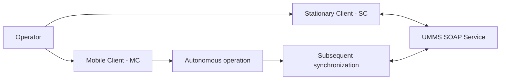

# UMMS — Enterprise SOAP API & Client System

> **Portfolio case study · Anonymized documentation sample**
>
> This document presents a redacted, high-level overview for portfolio purposes. It is not a complete production API specification. Confirm that publication is authorized before sharing any project-related information publicly.

## Table of Contents
- [Overview](#overview)
- [1. SOAP API Overview](#1-soap-api-overview)
  - [Interface Characteristics](#interface-characteristics)
  - [Method Catalogue](#method-catalogue)
  - [Illustrative Data Structures](#illustrative-data-structures)
    - [Document](#document)
    - [Address](#address)
    - [Reference-Book Entry](#reference-book-entry)
  - [Example Operation: "searchPersonFile"](#example-operation-searchpersonfile)
- [2. Client Architecture](#2-client-architecture)
- [3. Functional Scope](#3-functional-scope)
- [4. Technology Overview](#4-technology-overview)
- [5. Security and Confidentiality](#5-security-and-confidentiality)
- [6. Documentation Practices Demonstrated](#6-documentation-practices-demonstrated)

## Overview

UMMS is described here as an enterprise system with a SOAP interface and Windows-based client applications. The documented functional areas include person search, document and address management, document issuance, reference data, and information exchange between stationary and mobile clients.

This public sample intentionally excludes service URLs, credentials, production XML schemas, personal data, internal identifiers, and other confidential implementation details.

## 1. SOAP API Overview

### Interface characteristics

| Item | Description |
|---|---|
| Protocol | SOAP |
| SOAP versions | SOAP 1.1 and SOAP 1.2 |
| Service URL | Not included in this public sample |
| Credentials | Provided separately; not included |
| Detailed interface contract | Restricted / subject to authorization |

### Method catalogue

The method names and summaries below are included as a high-level catalogue. Exact parameter types, XML element names, response schemas, fault codes, and transaction semantics must be verified against an authorized interface specification before being documented as a production contract.

| Method | Purpose | Input summary | Output summary |
|---|---|---|---|
| `searchPersonFile` | Search for a person using specified criteria | Search criteria | List of persons |
| `getPersonDocuments` | Retrieve documents associated with a person | Person identifier | List of documents |
| `getPersonAddresses` | Retrieve addresses associated with a person | Person identifier | List of addresses |
| `getPersonCasesInfo` | Retrieve case information associated with a person | Person identifier | List of cases |
| `getDocumentDetail` | Retrieve document details | Document identifier | Document details |
| `getAddressDetail` | Retrieve address details | Address identifier | Address details |
| `getCountryDictionary` | Retrieve the country reference data | None specified | List of countries |
| `issueNewDocument` | Issue a document according to an established workflow | Issuance data | Operation result |
| `rollbackIssueNewDocument` | Request rollback of a document-issuance operation | Document identifier | Operation result |

### Illustrative data structures

The following fields are a conceptual summary, not a complete schema. Field types, requiredness, formats, and validation rules are not specified here.

#### Document

| Field | Description |
|---|---|
| Series | Document series, where applicable |
| Number | Document number |
| Dates | Relevant document dates; exact fields are unspecified |
| Issuing authority | Authority associated with the document |
| Type | Document type |

#### Address

| Field | Description |
|---|---|
| MAC code | Code referenced by the source description; exact meaning and format require confirmation |
| Text representation | Human-readable address representation |
| Type | Address type |

#### Reference-book entry

| Field | Description |
|---|---|
| Code | Reference entry code |
| Value | Human-readable value |

### Example operation: `searchPersonFile`

The supplied high-level description identifies date-from, date-to, and gender as search criteria. This sample does not include a SOAP envelope or XML schema because the exact namespace, element names, data types, and required fields must be taken from the authorized interface contract.

Before publishing a production-level example, verify:

- The exact request and response XML.
- Required and optional fields.
- Date and gender formats and allowed values.
- SOAP action and namespace details, where applicable.
- Fault responses and validation errors.
- Authentication and transport-security requirements.

## 2. Client architecture

The system description identifies two client modes:

- **Stationary Client (SC):** operates on the local network with continuous access to the service.
- **Mobile Client (MC):** supports autonomous operation followed by synchronization.

The diagram below is conceptual. It illustrates the described relationship between client modes and the SOAP service; it does not claim to reproduce a verified deployment architecture or synchronization protocol.

## 3. Functional scope

The described functional areas include:

- Searching for individuals using specified criteria.
- Managing document and address information.
- Issuing documents through established scenarios.
- Exchanging information between stationary and mobile clients.
- Supporting autonomous mobile operation and subsequent synchronization.
- Working with reference data, including countries and MAC-address-related codes.

The precise business rules, authorization checks, and synchronization conflict-resolution behavior are not defined in this public overview.

## 4. Technology overview

| Area | Technology or characteristic |
|---|---|
| Operating system | Windows |
| Application framework | .NET |
| User interface | Windows Presentation Foundation (WPF) |
| Service integration | SOAP |
| Local data handling | Encrypted files; format and encryption details unspecified |
| Digital signatures | Mentioned in the source description; algorithms and verification rules unspecified |

This table records only the technologies and characteristics identified in the supplied project summary. It does not imply that this case-study author designed or implemented the underlying system.

## 5. Security and confidentiality

This public sample intentionally omits:

- Production service URLs, usernames, passwords, tokens, certificates, and private keys.
- Real request or response payloads that may contain personal or confidential data.
- Internal identifiers and implementation-specific details.
- Cryptographic algorithms, key-management procedures, and authentication mechanisms not confirmed by an authorized specification.

Do not infer security behavior from the technology names alone. Verify all security-related claims against approved project documentation before publication.

## 6. Documentation practices demonstrated

This case study demonstrates how to organize a high-level interface overview into:

- A method catalogue with purpose, inputs, and outputs.
- Conceptual data-structure summaries.
- A client-mode and synchronization diagram.
- A technology overview.
- Explicit boundaries between verified information and details requiring confirmation.
- A confidentiality checklist for public portfolio material.

A production-ready specification would additionally require the authorized WSDL/XSD or equivalent contract, exact SOAP actions and namespaces, complete request and response examples, fault definitions, field-level validation rules, and versioning information.

